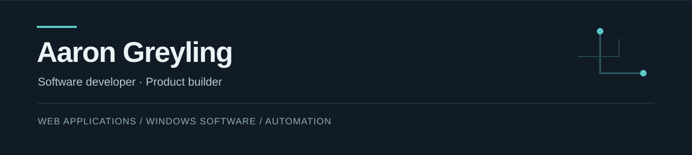
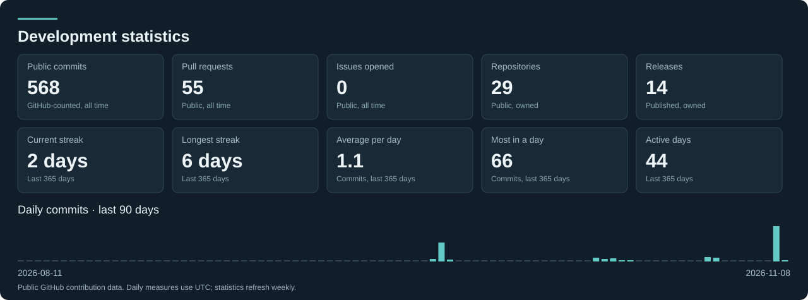

I build web applications, native Windows software, and tools that make digital work more efficient. I'm based in Leipzig, Germany and run [Fluent Studio](https://www.fluent-studio.com/en), an independent software studio.

[Portfolio](https://aaronpaulgreyling.netlify.app/) · [Fluent Studio](https://www.fluent-studio.com/en) · [LinkedIn](https://www.linkedin.com/in/aaron-paul-greyling-54a8a954)

## Selected work

### [FluentOverlay](https://www.fluent-studio.com/en/fluentoverlay)
**Windows productivity software · In development**

A context-aware Windows overlay for application-specific shortcuts and workflows.

`C#` · `WinUI 3` · `.NET`

### [Fluent Studio](https://www.fluent-studio.com/en)
**Software studio website**

Designed and developed the studio website, including multilingual content, software product pages, and Supabase integration.

`Next.js` · `React` · `TypeScript` · `Supabase`

### [FluentTimer](https://github.com/AaronPG095/FluentTimer)
**Windows desktop application · [Latest release](https://github.com/AaronPG095/FluentTimer/releases/latest)**

A native timer with a floating desktop widget, Pomodoro sessions, reminders, alarms, and time tracking.

`C#` · `WPF` · `.NET 10`

### [Kollektiv Spinnen](https://github.com/AaronPG095/kollektiv-spinnen-website)
**Festival platform · [Source code](https://github.com/AaronPG095/kollektiv-spinnen-website)**

A festival web application combining an interactive timetable, multilingual content, administration, and contribution-based ticketing.

`React` · `TypeScript` · `Supabase` · `PostgreSQL`

## Development workflow

I maintain [AI-Dev-Workflow](https://github.com/AaronPG095/AI-Dev-Workflow), a lightweight, multi-agent development process shared across Claude Code, Codex, Gemini/Antigravity and Cursor.

**Plan and approve → define acceptance criteria → track implementation and handoffs → review changes → verify with CI → ship.**

The repository includes a dependency-free Node.js CLI for tickets, progress logs and review packets; optional Notion task tracking; and GitHub Actions that enforce plan completion and verification before merging.

[Explore the workflow](https://github.com/AaronPG095/AI-Dev-Workflow)

## Technical focus

- **Web:** TypeScript, JavaScript, React, Next.js, HTML, CSS, Tailwind
- **Backend and data:** Node.js, Express, Supabase, PostgreSQL, MongoDB, MySQL, Laravel
- **Desktop:** C#, .NET, WinUI 3, WPF
- **Development:** Git, Docker, automated testing, AI-assisted development workflows

## Public development activity

<!-- profile-activity:start -->

**568** commits · **55** pull requests · **0** issues · **29** public repositories · **14** published releases

**2 days** current streak · **6 days** longest streak · **1.1** average commits per day

**Latest stable release:** [FluentTimer v0.3.0](https://github.com/AaronPG095/FluentTimer/releases/tag/v0.3.0) · 21 Oct 2026

**Recent pull requests:**
- [FluentTimer: feat: display multiple active timers in pill widget rows](https://github.com/AaronPG095/FluentTimer/pull/6) · 07 Nov 2026
- [FluentTimer: feat: add pinned multi-timer list mode to widget](https://github.com/AaronPG095/FluentTimer/pull/5) · 07 Nov 2026
- [FluentTimer: feat: add saved timers startup staging and auto-start](https://github.com/AaronPG095/FluentTimer/pull/3) · 07 Nov 2026

Commits follow GitHub contribution rules. Pull requests and issues are authored across public repositories. Repository and release counts cover repositories I own. Streaks and the daily average use the last 365 UTC days. Refreshed weekly.
<!-- profile-activity:end -->

## Background

Before moving into software development, I worked in professional kitchens and organized music events and festivals. That experience shaped how I approach software: start with real problems, build usable systems, and pay attention to reliability.

I completed full-stack web development training at DCI and a Laravel development internship at ECommeleon. I'm currently attending Studienkolleg Sachsen in preparation for university study in Digital Humanities, while continuing to build software through Fluent Studio.

## Contact

[Portfolio](https://aaronpaulgreyling.netlify.app/) · [LinkedIn](https://www.linkedin.com/in/aaron-paul-greyling-54a8a954) · [Fluent Studio](https://www.fluent-studio.com/en)
