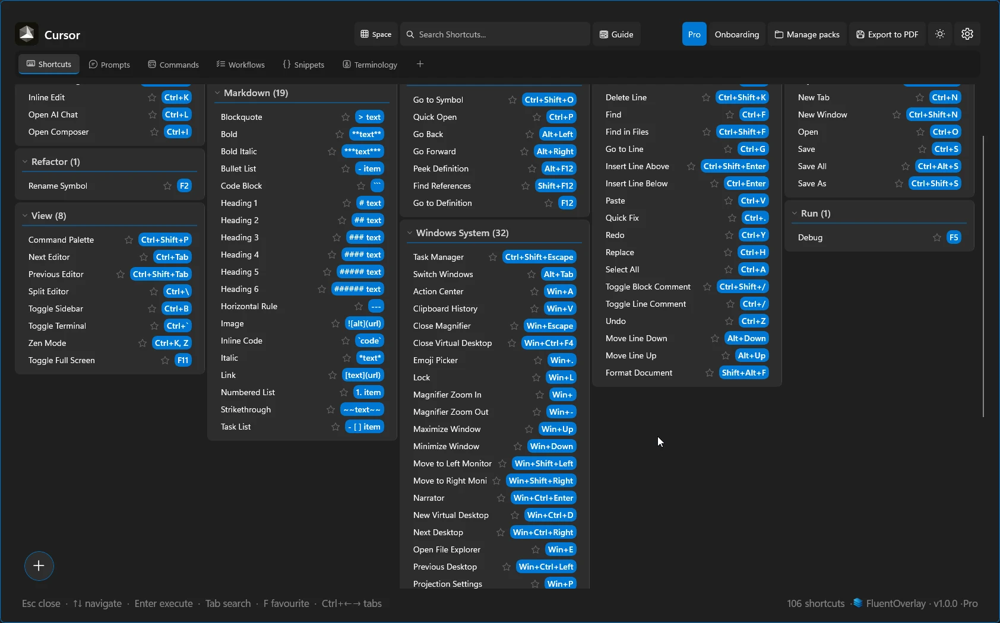
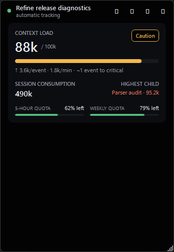

I build web applications, native Windows software, and deterministic tooling for AI-assisted development. Based in Leipzig, Germany, and founder of [Fluent Studio](https://www.fluent-studio.com/en).

[Portfolio](https://aaronpaulgreyling.netlify.app/) · [Fluent Studio](https://www.fluent-studio.com/en) · [LinkedIn](https://www.linkedin.com/in/aaron-paul-greyling-54a8a954)

## Selected work

| Project | What it does | Stack | Links |
|---|---|---|---|
| **FluentOverlay** | Context-aware Windows shortcut overlay using live UI Automation menu inspection, bundled JSON fallback packs, fuzzy recall, and an integrated MCP server | `C#` · `WinUI 3` · `.NET` | [Product page](https://www.fluent-studio.com/en/fluentoverlay) |
| **FluentTimer** | Native Windows tray timer with a floating widget, Pomodoro sets, interval reminders, alarms, CSV history, and SHA-256 verified self-updates | `C#` · `WPF` · `.NET 10` | [Repo](https://github.com/AaronPG095/FluentTimer) · [Release](https://github.com/AaronPG095/FluentTimer/releases/latest) |
| **TokenHUD** | Local-first Windows HUD tracking AI context load, token velocity, spikes, and quota windows from local SQLite and JSONL logs without reading message text | `C#` · `WPF` · `.NET` | [Repo](https://github.com/AaronPG095/TokenHUD) |
| **Fluent Studio** | Bilingual studio marketing, product, and documentation site with localized `en`/`de` routing and Supabase integration | `Next.js` · `React` · `TypeScript` · `Supabase` | [Website](https://www.fluent-studio.com/en) |
| **Kollektiv Spinnen** | Bilingual festival platform with an interactive timetable, event filters, admin tools, and contribution-based ticketing | `React` · `TypeScript` · `Supabase` · `PostgreSQL` | [Repo](https://github.com/AaronPG095/kollektiv-spinnen-website) · [Live](https://kollektiv-spinnen-timetable.vercel.app) |

Interface previews — FluentOverlay &amp; TokenHUD

<table>
  <tr>
    <td valign="top" width="66%">
      <strong>FluentOverlay</strong> 
      
    </td>
    <td valign="top" width="34%">
      <strong>TokenHUD</strong> 
      
    </td>
  </tr>
</table>

## Development workflow

I maintain [AI-Dev-Workflow](https://github.com/AaronPG095/AI-Dev-Workflow), a dependency-free Node.js harness shared across Claude Code, Codex, Gemini/Antigravity, and Cursor:

- **Deterministic Core:** zero-token session priming, verifiable acceptance criteria, single-pass review packets, and CI close-out gates.
- **Modular Agentic Engine:** opt-in step supervisor, role-isolated adversarial `builder ↔ reviewer ↔ fixer` loops, and parallel git worktree waves.

[Explore the workflow](https://github.com/AaronPG095/AI-Dev-Workflow) · [Agentic supervisor & wave closure (PR #24)](https://github.com/AaronPG095/AI-Dev-Workflow/pull/24) · [FluentTimer widget evidence (PR #6)](https://github.com/AaronPG095/FluentTimer/pull/6)

## Core stack & tooling

- **Application stack:** TypeScript, React, Next.js, C#, .NET 10, WinUI 3, WPF, Node.js, Supabase, PostgreSQL, SQLite
- **Verification & workflow:** Vitest, automated testing, Docker, MCP, GitHub Actions, multi-agent CI harnesses

## Development activity

<!-- profile-activity:start -->

**Latest stable release:** [FluentTimer v0.3.0](https://github.com/AaronPG095/FluentTimer/releases/tag/v0.3.0) · 21 Oct 2026

**Recent pull requests:**
- [AI-Dev-Workflow: Workflow Stats And Lessons](https://github.com/AaronPG095/AI-Dev-Workflow/pull/30) · 14 Nov 2026
- [FluentTimer: Display multiple active timers in pill widget rows](https://github.com/AaronPG095/FluentTimer/pull/6) · 07 Nov 2026
- [TokenHUD: Shared AI development process: plan, ticket, close-out gate](https://github.com/AaronPG095/TokenHUD/pull/1) · 31 Oct 2026

Statistics combine public and private activity visible to the refresh account. Lifetime commit and PR totals use GitHub search; repository and release counts cover owned repositories; monthly bars, streaks, and daily averages use the contribution calendar over the last 365 UTC days.
<!-- profile-activity:end -->

## Background

Before moving into software development, I spent nine years in professional kitchens and organized music events and festivals. That work shaped how I build software: start with real constraints, design systems people can rely on under pressure, and verify behavior before shipping.

I completed full-stack web development training at DCI and a Laravel development internship at ECommeleon. I'm currently attending Studienkolleg Sachsen in preparation for university study in Digital Humanities while building software through Fluent Studio.

---

Leipzig, Germany · [Email](mailto:aaron.p.greyling@gmail.com) · [Portfolio](https://aaronpaulgreyling.netlify.app/) · [Fluent Studio](https://www.fluent-studio.com/en) · [LinkedIn](https://www.linkedin.com/in/aaron-paul-greyling-54a8a954)
